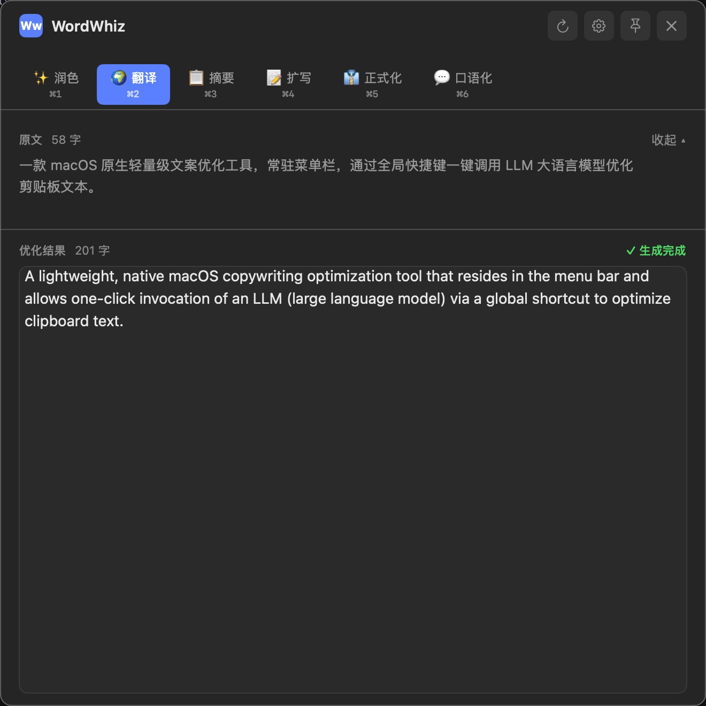

# WordWhiz

**macOS 菜单栏里的文案优化助手** —— 复制文本、按下全局快捷键，LLM 立刻开始流式优化，结果一键回填到任何应用。不切窗口、不打断思路。




*选中「翻译」指令（⌘2）后的实时效果：上方原文、下方流式生成的结果，生成完毕自动进剪贴板。*

> **声明**：本项目 100% 的代码均由 AI 生成，未包含任何人工编写的代码。

## ✨ 为什么用 WordWhiz

- **零打扰常驻** - 默认无 Dock 图标，安静住在菜单栏；需要时一个全局快捷键（默认 `⌃Z`，可自定义 6 种预设）唤出浮动面板
- **秒级工作流** - `⌘C` 复制 → `⌃Z` 唤出 → 流式出结果 → 直接 `⌘V` 粘贴回原处，全程手不离键盘
- **6 种内置指令，⌘1-6 瞬切** - 润色 / 翻译 / 摘要 / 扩写 / 正式化 / 口语化；切换即重新优化，也可以在「指令管理」里增删改自己的 Prompt
- **9 大模型服务开箱即用** - OpenAI、Claude、DeepSeek、通义千问、Gemini、Kimi、智谱 GLM、MiniMax，以及任意 OpenAI 兼容接口；每个服务商的 Base URL、模型名独立保存，一键测试连接
- **历史可追溯** - 自动保存最近 50 条优化记录，支持关键词搜索、一键复用
- **隐私优先** - API Key 只存本地 Keychain，历史记录只存本地数据库，文本只发往你自己配置的模型服务

## 🚀 安装

### 下载安装包（推荐）

前往 [Releases](https://github.com/dongritengfei/WordWhiz/releases/latest) 下载对应芯片的 DMG，拖入「应用程序」即可：

| 芯片 | 下载 |
|------|------|
| Apple Silicon (M1-M4) | `WordWhiz-v0.0.3-arm64.dmg` |
| Intel | `WordWhiz-v0.0.3-x86_64.dmg` |

首次启动会弹出引导，选择服务商、粘贴 API Key、测试连接，三步完成配置。

> 应用需要辅助功能权限来注册全局快捷键，请在「系统设置 > 隐私与安全性 > 辅助功能」中授权。

### 从源码构建

```bash
git clone https://github.com/dongritengfei/WordWhiz.git
cd WordWhiz
xcodebuild -project WordWhiz.xcodeproj -scheme WordWhiz -configuration Release build
```

构建产物位于 `~/Library/Developer/Xcode/DerivedData/WordWhiz-*/Build/Products/Release/WordWhiz.app`；也可运行 `./build_dmg.sh` 直接打包 DMG。

## ⌨️ 使用流程

1. **复制文本** - 在任意应用中选中文字，`⌘C`
2. **唤出面板** - 按 `⌃Z`，面板自动读取剪贴板并开始优化
3. **切换指令** - `⌘1-6` 换指令即时重新生成；`⌘R` 对同一指令重新生成；生成中可随时停止
4. **取用结果** - 生成完成后结果已自动复制到剪贴板（默认开启，可在设置关闭），直接 `⌘V` 粘贴回目标位置

### 快捷键

| 快捷键 | 功能 |
|--------|------|
| `⌃Z` | 全局唤出面板 / 触发优化（可在设置中更换） |
| `⌘ 1-9` | 切换到第 N 条指令并重新优化 |
| `⌘ R` | 重新生成 |
| `Esc` | 隐藏面板 |

### 更多设置

- **锚定模式** - 面板可钉在当前位置，拖到哪里记在哪里
- **面板位置** - 屏幕左 / 右 / 居中可选
- **开机自启**、**Dock 图标显隐**、**优化后自动复制**、**保留历史** 均可开关

## 🤖 支持的模型服务

| 服务商 | 默认模型 |
|--------|----------|
| [OpenAI](https://openai.com/) | gpt-4o |
| [Anthropic Claude](https://www.anthropic.com/) | claude-sonnet-4 |
| [DeepSeek](https://www.deepseek.com/) | deepseek-chat |
| [通义千问](https://tongyi.aliyun.com/) | qwen-plus |
| [Google Gemini](https://ai.google.dev/) | gemini-2.0-flash |
| [Kimi 月之暗面](https://www.moonshot.cn/) | moonshot-v1-8k |
| [智谱 GLM](https://open.bigmodel.cn/) | glm-4-flash |
| [MiniMax](https://www.minimaxi.com/) | MiniMax-Text-01 |
| 自定义 OpenAI 兼容接口 | 自填 |

## 🛠 技术栈

- **UI 框架**: SwiftUI（浮动 NSPanel 承载）
- **数据持久化**: SwiftData
- **全局快捷键**: HotKey (Carbon API)
- **网络请求**: URLSession + AsyncBytes（SSE 流式响应）
- **安全存储**: Keychain Services

## 项目结构

```
WordWhiz/
├── App/                    # 应用入口和生命周期
├── Views/                  # SwiftUI 视图
│   ├── Panel/             # 优化面板相关视图
│   ├── Settings/          # 设置窗口视图
│   ├── Onboarding/        # 首次启动引导
│   └── MenuBar/           # 菜单栏视图
├── ViewModels/            # 视图模型
├── Models/                # 数据模型
├── Services/              # 业务服务
│   └── LLM/              # LLM API 集成（SSE 流式）
├── Utilities/             # 工具类和常量
└── Resources/             # 资源文件
```

## 🔒 隐私说明

- API Key 仅存储在本地 macOS Keychain 中，不会上传到任何服务器
- 优化历史记录仅保存在本地 SwiftData 数据库
- 文本优化请求直接发送至用户配置的 LLM 服务商 API，无中间服务器

## 贡献

本项目 100% 代码由 AI 生成。欢迎提交 Issue 反馈问题或建议。

## 许可证

MIT License
